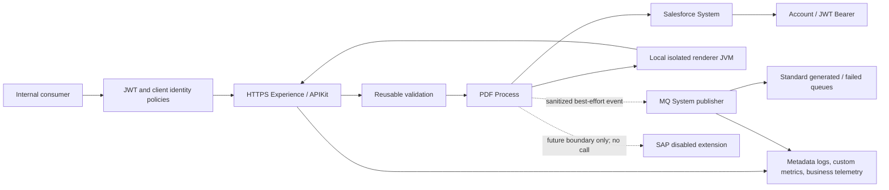
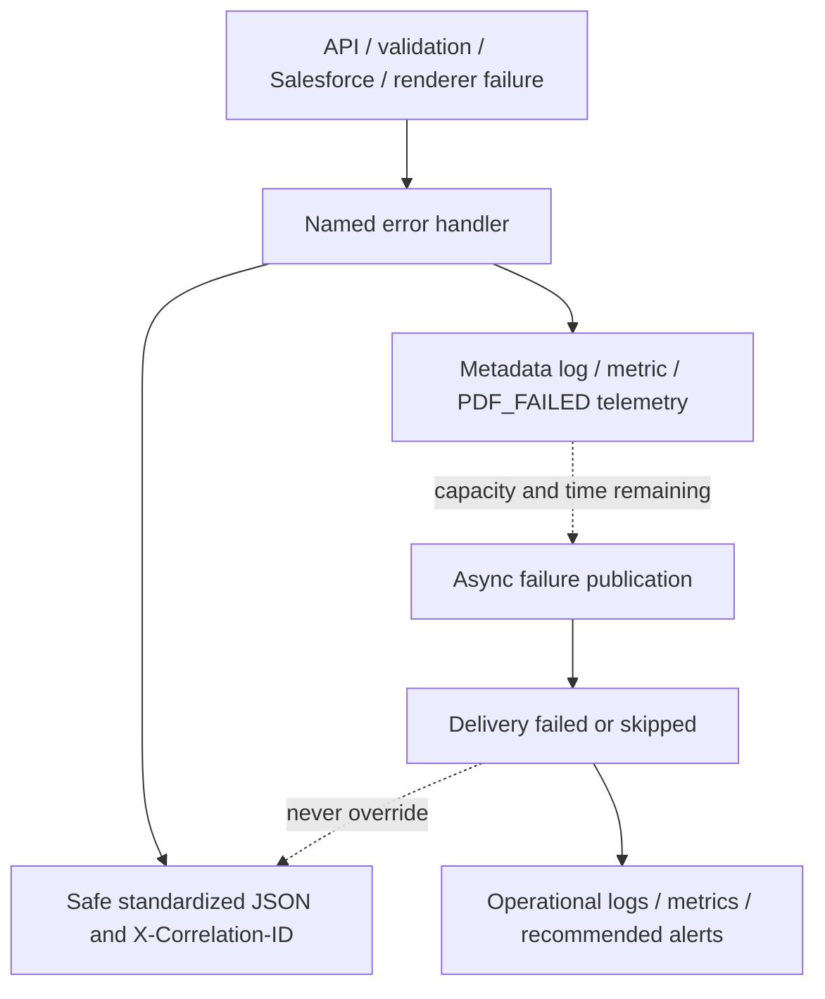
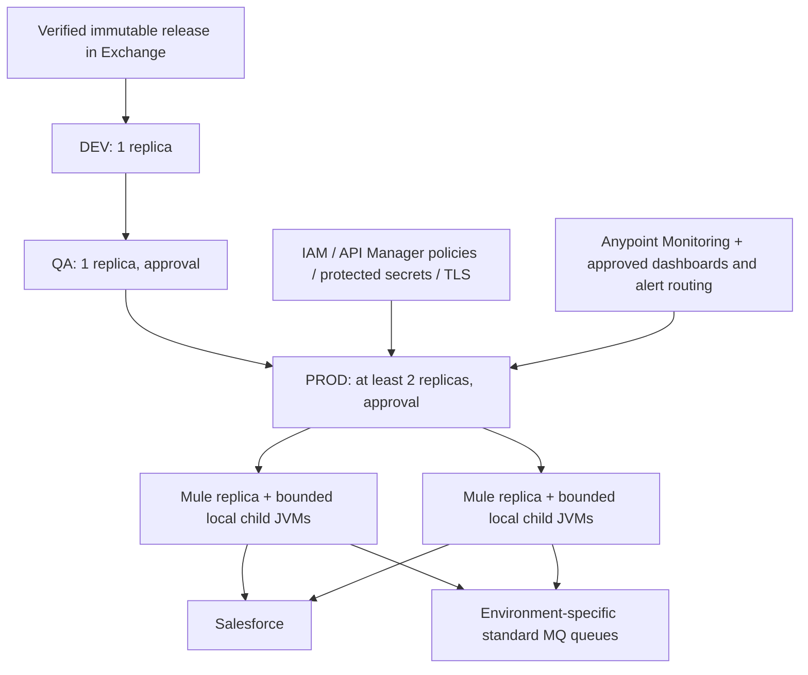

# Salesforce Account PDF API

Implementation against [approved context v1.2](project-context.md).
**Status: generated implementation, not a verified production release.**
ADR-001 remains Proposed. Mule/MUnit validation and the release gates below must
pass before deployment. Java support is explicitly authorized by FR-07/CON-06.

## API and business behavior

- `GET /documents/{recordId}` returns HTTP 200 `application/pdf`.
- Accept only 15/18-character alphanumeric Account IDs beginning `001`.
- Retrieve Id, Name, Phone, Website, Type, Industry, BillingCity, BillingCountry,
  AnnualRevenue and LastModifiedDate. No children, updates or document persistence.
- Id/Name are mandatory. Optional strings become `N/A`, missing revenue becomes
  `0`; revenue has no currency symbol, timestamps are UTC.
- Report is initially unbranded, with overflow pages rather than truncation.
- `GET /health` returns `{"status":"UP"}` without downstream calls.
- JWT and client identity policies apply to both endpoints. The application's
  header-presence check is **not** a substitute for JWT signature/claim validation.
- `X-Correlation-ID` is safe/bounded or replaced, then returned in every response.
- No JSON/Base64 wrapper is enabled. Download links require forbidden storage.

Errors use `{status:"FAILED",errorCode,message,correlationId}`:

| HTTP | Code | Outcome |
| --- | --- | --- |
| 400 | INVALID_ACCOUNT_ID | Missing/malformed Account ID |
| 401 | UNAUTHORIZED | Authentication/authorization failure |
| 404 | NOT_FOUND | Missing/inaccessible Account or unknown resource |
| 405 | METHOD_NOT_ALLOWED | Unsupported method |
| 502 | ACCOUNT_DATA_INVALID | Missing mandatory or malformed numeric/date source data |
| 503 | DEPENDENCY_UNAVAILABLE / CAPACITY_EXCEEDED | Dependency or render capacity unavailable |
| 504 | TIMEOUT | Salesforce/render/overall deadline exceeded |
| 500 | INTERNAL_ERROR / PDF_SIZE_EXCEEDED | Unexpected failure or document >2 MB |

## Project structure and main-to-business map

```text
pom.xml / mule-artifact.json
renderer/
  pom.xml
  src/main/java/com/enterprise/pdf/   child engine, process bridge, budgets/admission
  src/test/java/com/enterprise/pdf/   PDF and process isolation tests
src/main/mule/
  main-flow.xml                     listener and APIKit routes only
  account-generate-document-flow.xml Process orchestration
  salesforce-account-get-flow.xml    System read and classified retries
  pdf-render-document-flow.xml       renderer bridge
  health-get-flow.xml                runtime health
  mq-publish-business-event-flow.xml System publication
  sap-enrichment-extension-flow.xml  disabled, unreferenced extension
  common-*-subflows.xml              validation, metadata logs/metrics, events
  common-error-handlers.xml          named reusable handler
  *-config.xml                      configuration only
src/main/resources/
  api/                              RAML, trait, error type
  dwl/                              models, HTML, events, log/error contracts
  templates/account-summary.html
  properties/                       application, dev/qa/prod, secure.properties
  log4j2.xml
src/test/munit/ / src/test/resources/
deployment/pom.xml                   artifact-only promotion
```

All runtime XML files are directly under `src/main/mule`, loaded by Mule's default
configuration discovery. `mule-artifact.json` deliberately has no partial `configs`
list. Shared support classes are exported for the Java module.

| Entry / shared name | Delegation / responsibility |
| --- | --- |
| http-account-document-main | Metadata initialization -> APIKit -> route; named error handler |
| get:\documents\(recordId):account-pdf-api-config | account-generate-document-process |
| get:\documents:account-pdf-api-config | Missing-ID error |
| get:\health:account-pdf-api-config | health-get-process |
| account-generate-document-process | ID/deadline validation -> salesforce-account-get-system -> source validation -> DataWeave/HTML -> pdf-render-document-process -> output validation -> schedule-business-event-process |
| schedule-business-event-process | Metadata event -> fail-fast publisher lease -> async mq-publish-business-event-system |
| account-pdf-error-handler | ErrorContract -> safe JSON -> best-effort failure event |
| sap-enrichment-disabled-extension | Reject invocation; no references from PDF path |

## Architecture / diagrams (FR-05, DEP-07, DEP-22)

### Solution



### Sequence

```mermaid
sequenceDiagram
  participant C as Consumer
  participant E as APIKit
  participant V as Validation
  participant P as Process
  participant S as Salesforce System
  participant R as Child JVM
  participant M as Async MQ
  C->>E: Authorized GET /documents/{recordId}
  E->>V: Validate ID / correlation / budget
  V->>P: Valid request
  P->>S: Account query (classified bounded retries)
  S-->>P: Account
  P->>V: Mandatory and numeric/date validation
  P->>R: Escaped XHTML through stdin
  R-->>P: PDF through stdout
  P->>V: Size and deadline validation
  P-)M: Sanitized event, if capacity/time available
  P-->>C: PDF 200; MQ does not delay or alter response
  M->>M: Best-effort publish/retries within original deadline
```

### Error handling



### Deployment



### CI/CD

```mermaid
flowchart LR
  SRC[Source SHA] --> SCAN[Static analysis]
  SCAN --> JAVA[Renderer unit / process tests]
  JAVA --> MUNIT[Mule build + actual MUnit/coverage]
  MUNIT --> PKG[Package once + SHA256 + evidence]
  PKG --> EX[Publish same artifact to Exchange]
  EX --> DEV[Automatic DEV when ready]
  DEV --> QA[Protected QA approval]
  QA --> PROD[Protected PROD approval + exact QA artifact evidence]
```



## ADR-001 and renderer packaging (FR-07, CON-06)

Status **Proposed** until CloudHub 2.0 verification. Alternatives: embedded Java,
child JVM, sidecar, dedicated service. Only the local child-JVM direction is
authorized for this prototype. Same-JVM Future cancellation is not a hard stop.

Build the support module first. Its normal JAR supplies dependency-free bridge
classes to Mule; its `standalone` JAR contains OpenHTMLToPDF and its dependencies.
The application copies the standalone JAR into the artifact's resources. On first
startup, the Mule-managed Spring lifecycle bean extracts **code only** into an
owned temporary directory. Application disposal terminates owned children,
stops the watchdog, removes the JVM shutdown hook and removes the code directory;
JVM shutdown has a backup hook. HTML/PDF never go to a file; requests use memory
pipes. `lifecycle-config.xml` contains configuration only, not a business flow.

At most five child processes live per replica, with nonblocking admission. Each
has a 128 MB heap cap; native/metaspace costs are additional, so this is not a
128 MB total-memory guarantee. Watchdog termination uses only the owned Process
handle. The slot is released by `onExit`, not when a timed-out Future returns.
Crash/core/heap dumps are disabled. Rendering resource fetches are denied both
before and after URI resolution; initial template has no external assets.
Application lifecycle/redeployment cleanup must also be verified on CloudHub.
The template explicitly uses the Liberation Sans font packaged inside PDFBox,
rather than referencing an external font URL or application filesystem asset.
Font/script coverage for the organization's real Account names needs validation.

Library versions: Mule 4.9.4 (repository baseline), Mule Maven Plugin **4.6.1**
(4.6.2 from the template is not published), Salesforce 12.1.1, MQ 4.0.23,
HTTP/APIKit 1.11.0, Java module 2.0.0, Spring module 2.1.4 for managed lifecycle,
secure properties 1.3.0, metrics 2.3.1,
MUnit 3.7.0, OpenHTMLToPDF community fork 1.1.117/PDFBox 3.0.8.
Supply-chain/license review of the LGPL renderer and shaded notices is required.

## Reliability, pooling and caching (ERR-07, ERR-13, ERR-20..23, NFR-20..21)

Salesforce: connect 5s, login 5s, read 10s, connection cache/pool maximum 10.
Connectivity retry limit two with 3s spacing; no auth/validation/not-found retry.
Before an attempt, require at least 15s remaining. An attempt may be skipped even
though its maximum retry count has not been reached. No hidden reconnect strategy
is enabled. Token/session/connection reuse is not Account caching.

MQ: connect 1s, client/socket read 4s, two connectivity retries 1s apart; require
6s remaining before admission/each attempt. Five publisher leases, no durable or
waiting queue. MQ outcomes cannot rewrite PDF/error responses. Events keep one
eventId across retries; duplicates and loss during outages are expected. No
guaranteed delivery or persistent outbox is implemented.

**Release-blocking deadline gap:** connector/socket timeout settings and pre/post
budget checks do not by themselves prove termination of an in-flight Salesforce
or MQ operation. Authentication, lazy Salesforce iteration, SDK-internal HTTP
behavior and cancellation can exceed these composite budgets. The renderer's
local process cancellation is tested, but the full Mule 20s/async deadline
guarantees are not established. Do not release without resolving and measuring
ERR-07/ERR-21, including during degraded authentication/connectivity.

Streaming is used by the HTTP transport where applicable; bounded binary PDF and
HTML generation are in memory. No Account/PDF cache: every request reads fresh
source data. No batch, SAP connector, database, Object Store or archive.

## Configuration and secure provisioning (SEC-01..07, SEC-20)

Shared defaults are in `application.yaml`; `mule.env` selects dev/qa/prod.
External values have **no fabricated fallback**; unresolved values prevent startup.
`secure.properties` is intentionally empty except for provisioning guidance.
Provision an encrypted secure file via `secure.file` and its external `secure.key`;
verify the platform-specific delivery mechanism rather than assuming CloudHub
mounts arbitrary files. Anypoint Secrets Manager/certificate/private-key delivery
is an integration prerequisite, not provisioned by this repository.

| External property | Purpose |
| --- | --- |
| api.id | Provisioned API Manager instance; JWT/client policies required |
| http.tls.keystore / http.tls.alias | PKCS12 listener certificate/private-key location and alias |
| secure.file / secure.key | Environment encrypted property file and external decryption key |
| secure::http.secure.key-password / store-password | TLS secrets |
| salesforce.keystore / certificate-alias | JWT signing key/certificate location |
| salesforce.token-endpoint / audience | Approved environment auth endpoint and audience |
| secure::salesforce.secure.consumer-key / principal / store-password | Connected App and signing credentials |
| mq.url / mq.success-queue / mq.failure-queue | Approved MQ region endpoint and standard destinations |
| secure::mq.secure.client-id / client-secret | Least-privilege Connected App publish credentials |

IAM must provide issuer/JWKS/audience/scope and validate exp/nbf. Missing/invalid
JWT/client identity must produce normalized 401 at the gateway, including
X-Correlation-ID. Policy errors may bypass application handlers; test the
configured gateway, not just flow-level MUnit. Never enable HTTP wire logging,
default full-payload business-event tracking, or production debug logging.

MUnit uses the Mule Enterprise runtime. The POM declares the `MuleRepository`
plugin repository; Maven `settings.xml` must contain credentials under the same
server ID. Do not put repository credentials in the POM or this project.

## Build and verification

Use JDK **17** for Mule. Maven 3.9.16 and the JDK 17 installed with Anypoint Code
Builder were used for local validation; neither requires a global PATH change.

From this directory:

```powershell
mvn -B -ntp -f renderer\pom.xml install
mvn -B -ntp -s $env:MAVEN_SETTINGS -f pom.xml verify
```

The second command requires authorized Enterprise repository credentials in
`settings.xml` (server ID `MuleRepository`) and isolated test configuration,
supplied as Maven/MUnit system properties and files. Follow the build workflow
for the exact test property names and secure fixture handling. Tests use loopback
HTTPS, a test-only certificate/truststore, a free `http.port`, encrypted dummy
properties and inert connector endpoints. Never provide real Salesforce/MQ
credentials to tests. Downstream operations are mocked; gateway policies require
separate integration verification. No private keys/certificates are checked in.

The build workflow requires `MAVEN_SETTINGS_XML`, `MUNIT_MAVEN_OPTIONS`,
`MUNIT_SECURE_PROPERTIES` (encrypted test-only values), `MUNIT_TLS_PKCS12_BASE64`
and `MUNIT_TRUSTSTORE_BASE64` in GitHub secrets. It writes these only under the
runner temporary directory and supplies their paths to Maven. Test options supply
the test encryption key/store password/aliases, inert downstream endpoints and
free listener port. Certificates must be test-only with localhost SANs; do not
provide production keys or credentials. Secrets/settings are never artifact inputs.

For an offline diagnostic when Mule EE 4.13.0 and MUnit 3.7.5 are already
cached, use the same test-only fixtures and select the HTTPS suite:

```powershell
mvn -o -B -ntp test '-Dmule.version=4.13.0' '-Dmunit.version=3.7.5' `
  '-Dmunit.test=main-flow-test-suite.xml' '-Dmule.tlsStores.filesystemLookup.enable=true' @fixtureOptions
```

In this example, `@fixtureOptions` is a PowerShell array of `-Dname=value`
arguments: `mule.env`, `secure.file`, `secure.key`, `http.host` (`127.0.0.1`),
`http.port` (free port), `http.tls.keystore`, `http.tls.alias`,
`test.truststore`, `test.store-password`, `salesforce.keystore`,
`salesforce.certificate-alias`, `salesforce.token-endpoint`, `salesforce.audience`,
`mq.url`, and a dummy numeric `api.id`. Point the external connector URLs to an
unused loopback port and the store paths to temporary test files. The filesystem
flag lets this runtime read the temporary stores; TLS verification stays on.
These runtime overrides are for diagnostics only, not a change to the pinned
runtime or MUnit version.

### Actual evidence

- Renderer Maven `install`: **passed**, 6 unit tests + 4 packaged-child integration
  tests, zero failures/skips, compiled and executed on JDK 17.
- Mule `process-classes`: **passed** with the pinned connector schemas after
  correcting the MQ socket-property group and outbound JVM-default trust store.
- Mule `package`: **passed with tests explicitly skipped**; this verifies packaging
  only and is not MUnit or runtime evidence.
- Full `verify`: blocked before test execution because the local Maven settings
  lack `MuleRepository` credentials; fetching the Mule EE 4.9.4 runtime returned
  HTTP 401. The required server credentials must be provisioned locally and in
  the GitHub `MAVEN_SETTINGS_XML` secret.
- Offline diagnostic: **3/3 MUnit HTTPS tests passed** on cached Mule EE 4.13.0
  and MUnit 3.7.5. Real listener and APIKit routes returned health `200` with
  `{"status":"UP"}`, invalid Account ID `400` with the expected JSON error, and
  document `200 application/pdf` with the `%PDF-` signature, correlation header
  and `Cache-Control: no-store`. The Salesforce query, MQ publish and metrics
  were mocked. No live credentials or deployment were used.
- The focused run reached **84.03% application coverage** and Maven correctly
  failed the 90% gate. An earlier combined run on the cached versions hit
  MUnit configuration and renderer lifecycle startup errors in the other suites;
  those suites and the pinned-runtime run are not verified.
- Java tests do not establish MUnit coverage. Configured MUnit gates demand
  90% application/resource/each-flow processor coverage. These are not a proxy
  for percent of flows executed: inspect actual JSON for that separate metric.

See `target/surefire-reports/` for the focused run's per-test results. Re-run
all suites on the pinned runtime and repair failures before merge. Additional
gateway/load/degradation/cancellation cases remain required.

## Deployment, promotion and rollback (DEP-01..04, DEP-20..22)

Root workflows are [build](../.github/workflows/salesforce-pdf-build.yml) and
[promotion](../.github/workflows/salesforce-pdf-promote.yml); nested workflows
would not run. Build hashes one artifact and stores test evidence. Promotion
checks source/build provenance and checksum; it never recompiles.

Set GitHub protected environments `qa` and `prod` with required reviewers and
branch restrictions. GitHub YAML cannot create those protections. QA-verified
artifact SHA must match for PROD. DEV only starts automatically after
`PDF_DEV_READY=true`. Keep `PDF_RELEASE_READY` false until **every** release
blocker is resolved; flags are approval controls, not substitutes for evidence.

CloudHub 2.0 requires the same immutable release to be published to Exchange
first; organization coordinates/publication rights and region/vCores are missing.
The promotion POM has no application dependencies/build steps. Configure runtime
protected properties, TLS/last-mile routing, policies and secrets through the
approved platform procedure before setting ready flags; the POM supplies only
`mule.env`, not fictitious secret provisioning.

Command form, with approved values supplied by environment:

```powershell
mvn -B -ntp -s $env:MAVEN_SETTINGS -f deployment\pom.xml mule:deploy `
  "-Ddeployment.artifact=$env:MULE_ARTIFACT" "-Dexchange.group-id=$env:EXCHANGE_GROUP_ID" `
  "-Dplatform.uri=$env:PLATFORM_URI" "-Dplatform.environment=$env:PLATFORM_ENVIRONMENT" `
  "-Dcloudhub.target=$env:CLOUDHUB_TARGET" "-Dcloudhub.application=$env:CLOUDHUB_APPLICATION" `
  "-Dcloudhub.replicas=$env:CLOUDHUB_REPLICAS" "-Dcloudhub.vcores=$env:CLOUDHUB_VCORES" `
  "-Dmule.env=$env:MULE_ENV"
```

`DEPLOY_CLIENT_ID`/`DEPLOY_CLIENT_SECRET` are environment secrets consumed by
Maven, never source constants. Commands were not executed against any platform.
After deployment, perform authenticated health/PDF smoke tests with authorized
sanitized records and check metrics. Roll back by re-promoting the prior verified
Exchange artifact/checksum with its matching configuration and approvals. No
business-data replay or storage migration exists.

## Monitoring, reviews and release checklist

Custom metrics use low-cardinality phase/environment/event-type dimensions,
never record/transaction/correlation IDs as metric labels. JSON logs contain only
safe IDs, method/route template, status/media type/byte count, duration and safe
error codes. Business events: PDF_GENERATED, PDF_FAILED, SALESFORCE_RETRIEVED.
SAP_ENRICHMENT_COMPLETED is reserved only; SAP is uncalled and disabled.

Dashboard panels: API latency/status/success, Salesforce reads/retries/timeouts,
render latency/size/failures/live processes, MQ attempts/outcomes/retries/skips,
business-event occurrence vs delivery, replica memory/CPU/availability and
SAP-disabled state. Alert recommendations: availability, p95 >5s, 5xx >5%,
PDF failures >2%, memory >80%, repeated MQ failures/skips/capacity saturation.
These thresholds, destinations, retention and owners require operations approval.

Before release:

- Resolve Maven networking/repository authorization and run Mule/MUnit on JDK 17.
- Measure actual >=90% flow-execution and processor coverage; expand tests as needed.
- Validate APIKit route/schema behavior and gateway JWT/client rejection contracts.
- Resolve in-flight Salesforce/MQ deadline cancellation; verify async cleanup and
  response independence, including token acquisition and network degradation.
- Verify child-JVM support/permissions, packaging, redeployment shutdown and memory
  on CloudHub; do not relabel ADR-001 Accepted until evidence exists.
- Load test 60/minute, spike 120/minute, five renders/replica, <=2 MB, latency
  percentiles, 20s deadline, worker stability and safe capacity/error handling.
- Approve region/residency, owners/escalation, vCores, replicas, event retention,
  license/supply-chain review, dashboards and alert routing.
- Confirm Exchange publication, protected environments, secret/certificate
  provisioning and authenticated post-deploy verification.

Read-only security/performance/code review found no real secrets or disabled
certificate checks in generated source; this is **not** a penetration test or
passing production review. The unresolved deadline/auth/provisioning/build/
coverage items above are merge/release-blocking findings.
